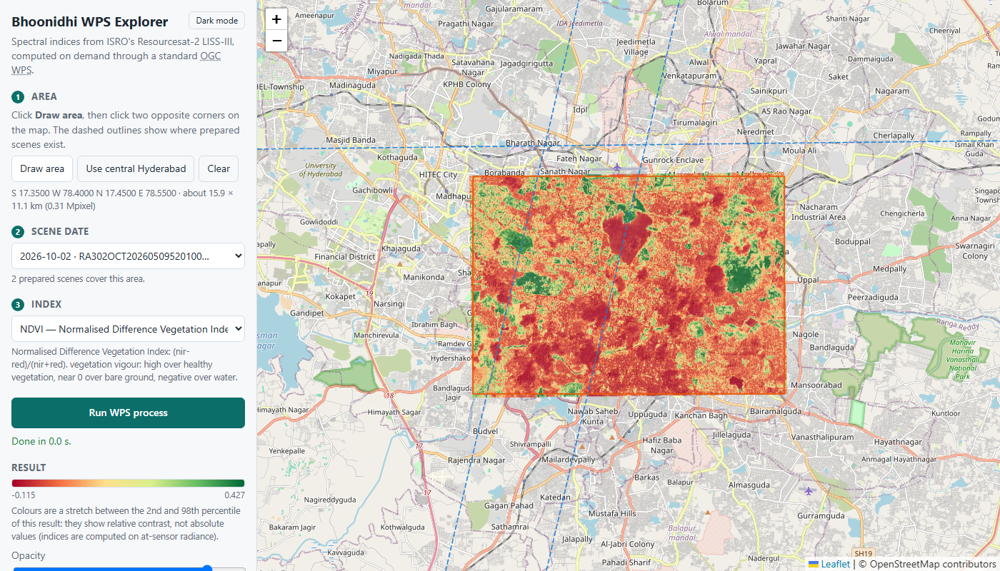

# Bhoonidhi WPS: spectral indices on demand from ISRO's EO archive

CyberGIS mid-sem assignment. An **OGC Web Processing Service (WPS 1.0.0, PyWPS)** that computes NDVI, NDWI, MNDWI or
NDBI for a bounding box from Resourcesat-2/2A LISS-III scenes published on
[Bhoonidhi](https://bhoonidhi.nrsc.gov.in), instead of making the user download a whole scene and compute it by hand.
It comes with an interactive map page that is simply a client of the WPS.



**Try it:** map page `https://bhoonidhi-wps-guntesh.malaysiawest.cloudapp.azure.com/` · WPS endpoint
`https://bhoonidhi-wps-guntesh.malaysiawest.cloudapp.azure.com/wps`
([GetCapabilities](https://bhoonidhi-wps-guntesh.malaysiawest.cloudapp.azure.com/wps?service=WPS&request=GetCapabilities)).
It runs on an Azure VM (Docker, Caddy with a Let's Encrypt certificate), always on while the VM is running; deployment steps
are in [docs/AZURE.md](docs/AZURE.md). The prepared scenes around Hyderabad (section 5) are served directly; for any other
area the map page offers to fetch a scene after you log in, on the page, to your **own** Bhoonidhi account (section 3 explains
what that means for your password). The website loads over HTTPS from the IIIT-H campus network (checked 2026-10-12); if it ever does not load from some
network, try another one such as a phone hotspot. A second copy runs from the author's laptop through an ngrok tunnel
(`https://triangle-overpass-flirt.ngrok-free.dev/`, only while the laptop is on, login switched off there); see
[docs/DEMO.md](docs/DEMO.md). Everything below can also be run locally (section 4).

**How it relates to Bhoonidhi:** it is an unofficial, external service built on data downloaded from Bhoonidhi, not part
of Bhoonidhi (only NRSC can add services to its own infrastructure). The pixels are real Bhoonidhi products and the
processing is real; the public instance serves a prepared subset, and a local instance can fetch further scenes from
Bhoonidhi, from the map page or the command line (section 4).

## 1. The gap

### What Bhoonidhi offers today
- A web portal (Browse & Order) for humans.
- A [Bhoonidhi API](https://bhoonidhi.nrsc.gov.in/bhoonidhi-api/): JWT authentication, a **STAC** search
  (`/data/collections`, `/data/search`) and a `/download` endpoint that returns the full product archive.
- A **Processing Tools** page (seen in the portal's menu on 2026-10-11) with *downloadable desktop utilities*: HDF-to-TIFF
  and NetCDF-to-GeoTIFF conversion, a DEM height conversion (WGS84 ellipsoidal to EGM96), a SAR toolbox (SARPOLTOOL), an
  EOS-04 ScanSAR mosaicking utility and an image viewer. They are programs you install and run on your own machine on data you
  already downloaded, for format conversion and SAR work; none of the ones I saw computes spectral indices, and none is a web service.
- Data is raw: a LISS-III product is a zip of four band GeoTIFFs (`BAND2..5.tif`, ~110 MB each) plus `BAND_META.txt`.

### What does not exist
Nothing in the API specification computes anything from the data, and the desktop utilities above are offline tools, not
an online service. Probing the portal host for OGC endpoints
(unauthenticated `GET`, 2026-10-05):

| Path on `bhoonidhi.nrsc.gov.in` | Result |
|---|---|
| `/wms`, `/wcs`, `/csw`, `/wps`, `/processes`, `/ogcapi`, `/conformance` | 404 |
| `/bhoonidhi-api/wps`, `/bhoonidhi-api/processes`, `/bhoonidhi-api/conformance` | 404 |

The API documentation lists STAC search and download only. This is absence of evidence, not a proof (I have also not
used every part of the portal, and a web-based processing feature behind a login could exist); I found no
Bhoonidhi WPS / OGC API - Processes service in the documentation or in searches.

### What a developer has to do today for "NDVI over my district"
1. Get an account and authenticate; search STAC; pick a scene.
2. Download the whole multi-band scene (~450 MB), unzip it.
3. Clip the Red and NIR bands to the area, handle the background and scaling, compute (NIR-Red)/(NIR+Red).
4. Repeat per date and per area.

Everything happens on the user's machine, so no web app, QGIS plugin or pipeline can simply *ask* for NDVI.

### Gaps I considered and rejected
| Idea | Verdict |
|---|---|
| CSW over scene metadata | Weak: discovery already exists as a STAC API (plus an unofficial public STAC mirror). A CSW would be a protocol shim. |
| WCS/WFS for raw imagery | Partly true, but serving whole licensed scenes needs heavy hosting and raises redistribution questions. |
| SOS / SensorThings | Bhoonidhi is a scene archive; no station/time-series observations were found. |
| **WPS for derived products** | **Chosen.** No processing interface exists. |

### Prior art, stated honestly
NRSC publishes a precomputed **AWiFS NDVI time-composite** product (100 m, 10x10 degree tiles, fixed 15-day windows,
whole-tile download). This service is different: on-demand for a caller-chosen bounding box and scene date (limited to the scenes loaded
into the service), 24 m LISS-III resolution, and a standard OGC interface that clients can discover and call.

## 2. The service

Endpoint (local): `http://localhost:5000/wps`

| Operation | Support |
|---|---|
| `GetCapabilities` | yes |
| `DescribeProcess` | yes |
| `Execute` | yes: KVP (GET) and XML (POST), synchronous and asynchronous (`storeExecuteResponse=true&status=true`) |

### Absolute values and reflectance, in the interface
The map page's **Advanced** section offers the quantity (`radiometry`) and the colour scale (`colour_scale`). The absolute scale is always available. Reflectance (`toa`) is built end to end and tested, but is **disabled until a cited per-band solar irradiance (ESUN) table is configured** in `app/esun_liss3.json` (a `source` and a value for each of bands 2-5, in mW/cm2/um); the option then switches on by itself, here and in the WPS (`/api/info` reports `toa_available`). I do not enter those numbers from memory, because wrong constants would give plausible but wrong reflectance. On radiance, the absolute scale makes NDVI look nearly flat (values sit near 0), which is why the relative stretch is the default.

### Choosing which Bhoonidhi scene to fetch
Where logging in is enabled, the date section has a **Find Bhoonidhi scenes** button with **From** and **To** calendar date
pickers (default: the last six months; quick buttons for 2 months, 6 months, 1 year, 3 years and everything since 2011). It logs you in if needed (the emailed code, in the page), searches Bhoonidhi for the online LISS-III scenes whose footprint
covers the drawn area, and lists them by date with the satellite. For the newest ten, the scene's true image footprint is read
from its public metadata file, so each entry says whether the tilted image really covers the area (any range back to 2011 can be
searched: it is searched in year-long windows, newest first, and the list shows the newest 40 with a note when older ones exist); scenes that do not are shown but
cannot be chosen. Pick a date and press **Run**: exactly that scene is downloaded (a chosen scene id goes to `/api/fetch`).
Without searching, a Run on an uncovered area still fetches the newest suitable scene, as before. The listing is a separate
helper endpoint (`/api/scenes`, rate-limited per session), not part of the WPS.

### Saved layers
Every result stays on the map as a **saved layer** (up to 20). The layers list has, for each layer, a show/hide box, its own
opacity slider, Zoom, move up/down in the stacking order, Rename and Remove, plus "Remove all". Clicking a layer's card (or
the layer on the map) selects it, and the *Selected layer* section then shows that layer's legend, statistics, download links
(GeoTIFF, preview PNG, WPS response) and the exact request behind it. Each layer card also has its own **Download: GeoTIFF · PNG · XML** links, named after the layer, so any layer can be downloaded without selecting it first. Running the identical request again selects the existing
layer instead of duplicating it; "Clear" only clears the drawn box. Layers live in the page (a reload clears them), and
stored result files on the server expire after `OUTPUT_TTL_HOURS`, so very old layers' download links stop working
while the layer itself keeps showing. Reading the value under the cursor is not offered (the preview image holds colours,
not values, and a server endpoint for it was out of scope).

### Interactive map page
`/` serves a small web page (Leaflet, vendored, no CDN): draw an area on the map (the prepared scenes are outlined),
pick a scene date and an index, press **Run WPS process**, and the result is overlaid with a legend, statistics, download
links and the exact WPS `Execute` request that was sent. An **OGC operations** section has a button for each of the three
operations (**GetCapabilities**, **DescribeProcess** with a process choice, and **Execute**); each shows the exact request
and the service's reply in the page, with "Open in a new tab" and "Copy as curl". Light and dark modes are supported.
The divider between the side panel and the map can be dragged to resize it (arrow keys also work, double-click resets; the width is remembered). The page computes nothing
itself: every result comes from an ordinary WPS request, so any WPS client can do the same. Helper endpoints feed it:
`/api/info` (indices and limits) and `/api/coverage` (outlines of the data actually available: the footprint intersected with
the pixels on disk, so the outline never claims more than a request can use).

**Fetching a scene from the page** (only where the instance runs with `BROWSER_LOGIN=1`). Draw an area no available scene
covers, and the date list offers "Newest scene on Bhoonidhi". Press **Run** and, if you are not logged in, a dialog asks
for your Bhoonidhi user id and password, then for the 6-digit code Bhoonidhi emails you; after that the pending Run
continues by itself (a progress bar shows searching, checking, downloading, unpacking) and the result appears. If you log
in by choice, with no Run pending, nothing is started. Details and security notes are in section 3.

### Processes
| Identifier | What it does |
|---|---|
| `ndvi` | NDVI for a bbox (the headline process). Output `ndvi`. |
| `spectral-index` | Same pipeline with a required `index` input: `ndvi`, `ndwi`, `mndwi` or `ndbi`. Output `index`. |

Both take the same other inputs and return the same three outputs (a GeoTIFF, a colour preview PNG and a stats JSON). Indices (LISS-III bands:
B2 green, B3 red, B4 NIR, B5 SWIR), each a normalised difference `(a-b)/(a+b)`:

| `index` | Formula | Highlights |
|---|---|---|
| `ndvi` | (nir-red)/(nir+red) | vegetation vigour |
| `ndwi` | (green-nir)/(green+nir) | open water (McFeeters) |
| `mndwi` | (green-swir)/(green+swir) | water vs built-up (Xu) |
| `ndbi` | (swir-nir)/(swir+nir) | built-up land |

Not offered: **EVI** (needs a Blue band, which LISS-III lacks) and **SAVI** (its soil constant 0.5 is defined for
reflectance and is meaningless on radiance; it waits for TOA reflectance).

### Process `ndvi` (inputs and outputs; `spectral-index` adds an `index` input and names its output `index`)
| | Identifier | Type | Notes |
|---|---|---|---|
| Input | `bbox` | BoundingBox, `EPSG:4326` | OGC axis order for EPSG:4326: `miny,minx,maxy,maxx` (lat,lon). Required. |
| Input | `date` | Literal (string) | `YYYY-MM-DD`. Optional; default is the newest scene that fully covers the bbox. |
| Input | `radiometry` | Literal, `radiance` \| `toa` | Optional, default `radiance`. `toa` = top-of-atmosphere reflectance; it is implemented but **refused with an explanatory error until a cited per-band solar-irradiance (ESUN) table is configured** (see section 5). |
| Input | `colour_scale` | Literal, `stretch` \| `absolute` | Optional, default `stretch`. Affects the **preview image only**, never the GeoTIFF: `stretch` colours the 2nd-98th percentile of this result (relative contrast), `absolute` uses a fixed -1 to +1 scale so the same colour means the same value in every request. |
| Output | `ndvi` | Complex, `image/tiff; subtype=geotiff` | Float32 Cloud Optimized GeoTIFF, NaN = no data, in the scene's UTM CRS. Returned by reference. |
| Output | `preview` | Complex, `image/png` | Colour PNG in latitude/longitude for web maps: no-data transparent, colours stretched between the 2nd and 98th percentile (relative contrast only). Its map bounds and legend are in `stats`. |
| Output | `stats` | Complex, `application/json` | scene id, date, bbox, shape, min/mean/max, valid fraction, radiometry mode, preview bounds and legend. |

Errors are returned as proper OGC `ExceptionReport`s (unknown process, invalid or inverted bbox, bbox over the size
limit, bad date, no scene covering the request).

### Response options
| Option (KVP / XML) | Effect |
|---|---|
| default | XML `ExecuteResponse` with a link to the GeoTIFF and the stats JSON inline |
| `RawDataOutput=ndvi` / `<wps:RawDataOutput>` | Returns the GeoTIFF itself (`image/tiff; subtype=geotiff`), no XML |
| `RawDataOutput=stats` | Returns the statistics JSON itself (`application/json`) |
| `ResponseDocument=ndvi@asReference=true` | Choose which outputs appear, and whether as a link |
| `lineage=true` / `lineage="true"` | The response also echoes the inputs received and the outputs requested |
| `storeExecuteResponse=true&status=true` | Asynchronous: immediate `ProcessAccepted` + status URL to poll |
| unknown output name | OGC `ExceptionReport` (`InvalidParameterValue`, HTTP 400) listing the valid names |

### Examples
```bash
# capabilities and process description
curl "http://localhost:5000/wps?service=WPS&request=GetCapabilities"
curl "http://localhost:5000/wps?service=WPS&version=1.0.0&request=DescribeProcess&identifier=ndvi"

# synchronous Execute (central Hyderabad, ~10 x 15 km)
curl "http://localhost:5000/wps?service=WPS&version=1.0.0&request=Execute&identifier=ndvi&DataInputs=bbox=17.35,78.40,17.45,78.55,urn:ogc:def:crs:EPSG::4326"

# raw GeoTIFF straight to a file, and raw statistics
curl -o ndvi.tif "http://localhost:5000/wps?service=WPS&version=1.0.0&request=Execute&identifier=ndvi&DataInputs=bbox=17.35,78.40,17.45,78.55,urn:ogc:def:crs:EPSG::4326&RawDataOutput=ndvi"
curl "http://localhost:5000/wps?service=WPS&version=1.0.0&request=Execute&identifier=ndvi&DataInputs=bbox=17.35,78.40,17.45,78.55,urn:ogc:def:crs:EPSG::4326&RawDataOutput=stats"

# asynchronous Execute: returns ProcessAccepted + statusLocation; poll that URL for ProcessSucceeded
curl "http://localhost:5000/wps?service=WPS&version=1.0.0&request=Execute&identifier=ndvi&DataInputs=bbox=17.35,78.40,17.45,78.55,urn:ogc:def:crs:EPSG::4326&storeExecuteResponse=true&status=true"
```
Python client: `python scripts/owslib_check.py [wps_url]` drives all operations with OWSLib (tested). Results are
ordinary Cloud Optimized GeoTIFFs and load in QGIS as raster layers (Layer > Add Raster Layer, local file or URL).
QGIS 3 has no built-in WPS client, and I have not tested a WPS plugin; any WPS 1.0.0 client should work with the same URL.

### Conformance verification
- **Schema validation.** Responses are validated against the official OGC WPS 1.0.0 and OWS 1.1 XSDs (vendored in
  `tests/schemas/`): GetCapabilities, DescribeProcess, synchronous Execute, `ExceptionReport`, the asynchronous
  `ProcessAccepted` response and the final `ProcessSucceeded` / `ProcessFailed` status documents.
  `pytest tests/test_schema.py` covers the synchronous documents; `python scripts/validate_schema.py [wps_url]`
  runs the full asynchronous lifecycle against a running server.
- **Independent client.** `python scripts/owslib_check.py [wps_url]` drives GetCapabilities, DescribeProcess and an
  asynchronous Execute with status polling through OWSLib.
- The suite found several places where PyWPS 4.8 violates the schemas or the OGC axis-order convention; these are
  fixed in `app/pywps_compat.py` (see section 3). The response options above (`lineage`, `RawDataOutput`,
  `ResponseDocument`) are tested too, over both KVP and XML POST.
- **Version handling.** Only WPS 1.0.0 is advertised, and a request for another version gets an OGC `ExceptionReport`
  (`VersionNegotiationFailed` for `GetCapabilities`, `InvalidParameterValue` on `version` otherwise). PyWPS by itself also
  advertised 2.0.0 while answering with 1.0.0 documents.
- Not covered: WPS 2.0, `Reference` inputs, the official OGC CITE test suite, and every possible request variant.

## 3. Design and implementation choices
- **PyWPS 4.8 on Flask + gunicorn, in Docker.** PyWPS asynchronous execution uses `multiprocessing` and does not work
  on Windows, so the service is run in Docker (Linux).
- **Pipeline** (`app/`): find scenes whose *actual pixels* cover the bbox -> reproject the bbox into the scene's UTM zone
  -> read only the needed rows of the two bands the chosen index uses (windowed read) -> DN to radiance using the
  per-band `Lmin/Lmax` in `BAND_META.txt` -> index -> write a COG.
- **Scene selection uses real pixel coverage.** Scenes are tilted, so a bounding rectangle overstates coverage; the
  18 May scene's rectangle contains central Hyderabad but its slanted edge cuts through it (45% valid), so it is rejected.
- **COG for outputs and for the cache, not for the sources.** The source tifs are uncompressed and row-striped, so a
  bbox clip already reads little; converting them would gain nothing.
- **Two data modes, one code path.** Full scenes (local, from `data/`) or a pre-clipped cache (public). The cache has
  the same folder layout (`BAND2..5.tif` + `BAND_META.txt`) with small compressed COG bands of the *original* DN values;
  NDVI from the cache was checked to be bit-identical to NDVI from the full scene for the Hyderabad demo window. `scripts/build_cache.py` builds it from scenes you
  downloaded yourself; the public image contains only this cache (~38 MB for both scenes) and no credentials.
- **PyWPS conformance fixes** (`app/pywps_compat.py`, applied at import so they survive reinstalls):
  - Axis order: PyWPS 4.8 delivers XML-POST bounding boxes as lon,lat but KVP as lat,lon. Both now follow the OGC
    convention (lat,lon for EPSG:4326); regression tests cover both encodings.
  - A failed process was reported as `wps:ExceptionReport` (the schema requires `ows:ExceptionReport` with a `version`
    attribute), and `ProcessAccepted` carried a `percentCompleted` attribute the schema does not allow.
  - `serviceInstance` was double-escaped (`&amp;amp;`), advertising a wrong URL.
  - Process keywords and an input without an `AnyValue` also made capabilities/DescribeProcess schema-invalid; fixed in
    the process definition.
- **Shared job database.** PyWPS tracks running async jobs in a database that defaults to `sqlite:///:memory:`, which is
  private to each process. Async jobs run in forked children, so the server never saw them finish and, after
  `parallelprocesses` (2) jobs, queued every new async job forever. `app/server.py` points it at a file database
  (reset at start-up; one gunicorn worker).
- **Fetching scenes from Bhoonidhi** (`app/bhoonidhi_client.py`, `app/live_fetch.py`, `scripts/fetch_scene.py`;
  verified against the real Bhoonidhi, see section 5). Search uses the official STAC API (`POST /data/search`; online
  Resourcesat-2/2A LISS-III standard products whose footprint contains the area). The official API's `/download`
  refused every way of sending the token ("Invalid session detected"), so the download uses the **portal's own
  route**, as the unofficial open-source client does: log in to the portal (a separate login that emails a one-time
  code), ask the portal's search for the scene's real directory and file name, then `GET /bhoonidhi/data/<satellite>/<sensor>/<year>/<MON>/<file>.zip`.
  Only the four bands and `BAND_META.txt` are unpacked, and real pixel coverage is checked before the scene is
  accepted. Bhoonidhi's footprints are rectangles but the images are tilted: a 9 Oct 2026 scene that the search listed as
  covering Hyderabad had 0% valid pixels in the city centre and was correctly refused. At most two downloads are made
  per request, logins and searches respect the documented rate limits, retries wait, and secrets are scrubbed from every
  message.
- **Logging in and fetching from the page** (`app/webauth.py`, `app/fetchjobs.py`; off unless `BROWSER_LOGIN=1`).
  The password is posted once to `/api/login`, used only to log in to Bhoonidhi, and not stored or logged (a password
  field is cleared in the page as soon as it is sent); the emailed code goes to `/api/otp`. The server keeps the logged-in
  Bhoonidhi client in memory against a random session id in an `HttpOnly`, `SameSite=Strict` cookie (30 minutes idle,
  2 hours at most), and state-changing calls need a custom header (CSRF). Logins and wrong codes are rate-limited, a
  session runs one fetch at a time and the server at most two. Fetched scenes go to `data/_fetched`, are shared with
  later visitors, and are deleted after `FETCH_TTL_HOURS` (default 6) or when `_fetched` exceeds `FETCH_MAX_GB` (default 3).
  **Honest caveats:** the service host sees your Bhoonidhi password while logging you in, so use this only on an instance
  you trust and reach over HTTPS; a tunnel such as ngrok can also read the traffic, which is why the public demo address
  has it switched off. Before a ~140 MB download the open-data scene's small `.meta` file is read to check its true image
  footprint, so scenes that only the bounding rectangle claims to cover are skipped (if the file cannot be read, the
  scene is kept and the pixel check after download decides).
- **Strict MIME type** `image/tiff; subtype=geotiff` on the output, and `/outputs/` is served statically so async
  status documents and results are reachable.
- **Bounded cost:** requests above 16 Mpixel (~96 x 96 km at 24 m, `MAX_PIXELS`) are rejected.
- **Bounded disk:** a background thread deletes stored results older than `OUTPUT_TTL_HOURS` (default 24;
  `app/cleanup.py`, tested).
- **Service identity:** GetCapabilities carries project metadata (title, abstract, keywords, access constraints,
  repository as contact point) from the `[metadata:main]` section of `pywps.cfg`, not PyWPS's placeholder text. No
  personal contact details are published.

## 4. Run it
```bash
# one-off: scenes you downloaded from Bhoonidhi go in data/ (git-ignored), one folder per scene
python -m venv .venv && .venv/Scripts/pip install -r requirements.txt
.venv/Scripts/python scripts/build_cache.py            # data/ -> cache/ (Hyderabad area)

docker build -t bhoonidhi-wps .                        # image bakes in cache/
docker run -p 5000:5000 bhoonidhi-wps                  # public-style, cache only
# or with full scenes:  docker run -p 5000:5000 -v "$PWD/data:/srv/data:ro" bhoonidhi-wps
# behind a tunnel, tell the service its public URL so status/output links are correct:
#   docker run -p 5000:5000 -e PUBLIC_BASE_URL=https://<your-tunnel> bhoonidhi-wps
```
### Fetching more scenes from Bhoonidhi (needs your own Bhoonidhi account)
**From the map page** (no `.env` file needed; you type your credentials into the page):
```bash
BROWSER_LOGIN=1 PORT=5001 .venv/Scripts/python -m app.server   # then open http://127.0.0.1:5001/ (Linux/macOS: .venv/bin/python)
# PowerShell:  $env:BROWSER_LOGIN="1"; $env:PORT="5001"; .\.venv\Scripts\python -m app.server
# (use 127.0.0.1, not localhost: a Docker container on port 5000 may answer on localhost instead)
```
Or without a Bhoonidhi account, to try the whole flow against a made-up archive: `python scripts/dev_fake_bhoonidhi.py`
(password `correct-horse`, code `123456`, draw a box around 80.6 E 16.5 N). The browser flow is also tested end to end in a
real Chrome: `tests/e2e/` (see its README).

**From the command line:**
```bash
cp .env.example .env        # fill in BHOONIDHI_USER and BHOONIDHI_PASSWORD; .env is git-ignored, never share it
python scripts/fetch_scene.py --bbox 17.35,78.40,17.45,78.55 --dry-run                      # log in + search, downloads nothing
python scripts/fetch_scene.py --bbox 17.35,78.40,17.45,78.55 --date 2026-10-02 --download-auth portal
#   -> asks for the 6-digit code Bhoonidhi emails you, downloads ~140 MB into data/, checks real pixel coverage
python scripts/build_cache.py && docker build -t bhoonidhi-wps .                           # serve the new scene
```
(`--bbox` is `miny,minx,maxy,maxx`.) A WPS `Execute` request on its own never logs in: the portal login needs a fresh
emailed code, which only a person can supply. That is why fetching is a separate step (the page's login dialog, or the
script) and the WPS then serves what is on disk. Never put credentials in the image or the repository, and never enable
`BROWSER_LOGIN` or `BHOONIDHI_LIVE` on a publicly exposed instance without HTTPS you control.

A step-by-step live demo script: **[docs/DEMO.md](docs/DEMO.md)**.

How the pieces fit together, Docker/ngrok basics and troubleshooting: **[docs/HOW_IT_WORKS.md](docs/HOW_IT_WORKS.md)**.

Tests: `.venv/Scripts/python -m pytest` (the real-data tests are skipped if `data/` is empty).
`scripts/inspect_scene.py <scene folder or zip>` prints tif header metadata.

## 5. Known limitations
- **Radiance by default; TOA reflectance is built but disabled.** Indices are computed on at-sensor radiance.
  `radiometry=toa` is implemented (formula from NRSC's own surface-reflectance guide, tested against hand calculations)
  but needs the per-band solar irradiance (ESUN). I could not find a citable open source for the LISS-III values and did
  not guess them, so the service refuses `toa` until `app/esun_liss3.json` is filled from a publication (`later.md` says
  how). Radiance carries no solar-irradiance correction; since red sunlight is stronger than NIR, NDVI is expected to be
  biased low (the Hyderabad 23 May clip has a median NDVI of about -0.05; 2 Oct is greener, about +0.06 on the mean, as expected after the monsoon, but the sensors differ so compare patterns, not numbers), but I could not quantify the bias without
  the ESUN values. Treat values as relative. The priced BOA surface-reflectance product is the proper alternative.
- **Prepared scenes are the four shown on the map** (the ngrok copy serves only these, with login off; the Azure instance and
  a local instance with `BROWSER_LOGIN=1` can fetch more for a visitor who logs in): four scenes around Hyderabad, each cut to
  about 65 x 55 km: 18 and 23 May 2026 (Resourcesat-2), 2 Oct 2026 (Resourcesat-2A) and 9 Oct 2026 (Resourcesat-2). The 18 May and
  9 Oct scenes are on the tilted western track and cover only the west of the city centre, so for the central-Hyderabad
  demo box the choices are 23 May and 2 Oct. Anything else returns a clean "no scene covers this request" exception.
- **Result files expire.** Stored results (the status document and `ndvi.tif` for async or reference responses) are
  deleted after `OUTPUT_TTL_HOURS` (default 24) so a long-running public instance does not fill its disk; request again
  to get a fresh link.
- **Fetching from Bhoonidhi needs a person with an account.** Verified against the real Bhoonidhi on 2026-10-11 by the
  account owner, through the command-line script: API login and STAC search; the portal login with its emailed one-time
  code; the portal's own search; a 141 MB download and unpack; and the coverage check (it accepted the 2 Oct
  Resourcesat-2A scene at 100% and refused the 9 Oct scene). The browser login-and-fetch flow was tested end to end in
  real Chrome against a **fake** Bhoonidhi (`scripts/dev_fake_bhoonidhi.py`, 19 checks), and the account owner then used it
  with the real Bhoonidhi (2026-10-11): logging in on the page with the emailed code and fetching a scene for an area
  outside the prepared data worked. The footprint pre-check was also confirmed on the real portal (2026-10-11): the scene's public `.meta` file was read, and
  it showed that the 9 Oct 2026 scene, which the search lists as covering central Hyderabad, does not truly cover it, so
  it would be skipped before the 141 MB download. The portal route uses endpoints NRSC does not
  document, learnt from a third-party client, so it may change. The documented official `/download` was refused
  ("Invalid session detected") for every way of sending the token; the cause is unknown (possibly an account
  permission). The public instance never has credentials and does not log anyone in.
- **Some older scenes are refused by Bhoonidhi.** For several 2021-2023 Resourcesat-2/2A scenes the portal's own search lists the product as `OpenData_DirectDownload`, yet its download path answers HTTP 404 with a "permission denied" page, the same from the server and from a laptop (2026-10-12), while 2020 and 2026 scenes downloaded. The cause is on Bhoonidhi's side (an account or product permission); the service reports it as a refusal (not a missing file) and marks the scene in the list. Reported to NRSC: not yet.
- **Searches are complete.** One Bhoonidhi search returns at most 100 scenes and cuts an over-full answer off (the newest were missing from a year-long search), so a full page is split into smaller date ranges until nothing is cut off.
- **Rate limits.** Bhoonidhi limits requests per *server* address, shared by everyone using that server: about 3 searches a second and **20 logins an hour** (the documented limits), and it may limit the portal too. This service spaces its portal requests out, looks each scene up once, and explains an HTTP 429 with the wait the portal asks for; the service's own limits are 10 login or code attempts a minute per visitor, 5 wrong codes per login and one scene search every 4 seconds per session. After many logins in a row (testing, "Start over"), expect to wait up to an hour. Running your own copy gives you your own address.
- **No cloud masking, only a hint.** Bhoonidhi's cloud percentage is empty in the scene metadata, so the service cannot filter by it. Instead every result carries a rough `cloud_hint` in its statistics (and the page shows a warning on the layer): the share of pixels whose green-band radiance is far above anything clear land gave (more than 15 mW/cm2/sr/um), reported as "cloud or haze **may** be present" at 10% or more and "may cover much of the area" at 50% or more. It comes from six scenes: the clear ones had a mean green radiance of 3.9 to 7.8 and at most 5% of pixels above the limit, the overcast 12 Aug 2020 scene 23.4 and 94%. Bright ground (sand, roofs) can trigger it and thin cloud or haze can slip under it, so it is a warning, not a mask, and the index values themselves are never changed. The scene list cannot show it, because it needs the pixels; single-scene results, no mosaicking or
  time-series; scenes lie in different UTM zones (43N/44N), so combining them would need reprojection.
- **On radiance, only relative contrast is meaningful, not absolute values or standard thresholds.** Real example
  (Hyderabad, 23 May): every pixel has a positive MNDWI (minimum 0.61) and the median NDBI is -0.66, most likely because the
  SWIR band's radiance range (Lmax 7.5) is tiny next to green's (Lmax 52); not verified. The indices do pick out the right places: Hussain Sagar lake sits at
  the 99th percentile of NDWI/MNDWI and the 1st percentile of NDVI/NDBI in the window (checked by an automated test, which
  also confirms band wiring and geolocation). Do not apply "NDWI > 0 means water" until reflectance is available.
- Four indices; SAVI and EVI are not offered (see Processes).
- Not independently validated against a reference NDVI product. Manual checks done by the author: the GeoTIFF output
  loads in QGIS over central Hyderabad with the expected CRS and layout, and the public URL answers from a phone on
  mobile data. The automated lake test is a relative check only. The map page's colours were checked in headless-browser screenshots; the click-to-draw interaction itself is not covered by an automated browser test.

## 6. Data, attribution and the licence

Contains data from Resourcesat-2/2A LISS-III, **ISRO-IRS**, distributed through Bhoonidhi (NRSC/ISRO). Scenes are not
redistributed in this repository (`data/` and `cache/` are git-ignored), and the service never serves the raw bands: it
serves *derived* index rasters, previews and statistics.

I read the Bhoonidhi End User Licence Agreement (EULA, shown on the portal's login page, read 2026-10-11) and compared it
with what this service does. This is my reading of the text, not legal advice.

| EULA clause (paraphrased) | What the service does |
|---|---|
| Data of 5 m ground sampling distance or coarser, and derived thematic data, is free and open to registered users, "as is where is". LISS-III is 23.5 m. | Only LISS-III (open data) is used. |
| NRSC grants a worldwide, royalty-free right to "publish, reproduce, distribute, communicate in public domain, combine with other datasets" the free and open data, so far as lawful. | Derived indices are published openly; raw bands are never served. |
| "Acknowledgement or credit of the data should be provided by including a text citation... The attribution to be used in caption shall be **ISRO-IRS**." | The map page footer, this README, each output GeoTIFF (tags `ATTRIBUTION=ISRO-IRS`, `SOURCE`, `SCENE_ID`) and the statistics JSON (`attribution`) carry it. |
| Data must be used for lawful services; "the original data will not be re-distributed on commercial basis" and "shall not be commercialized in its original form". | Non-commercial coursework; original data is not redistributed at all. |
| Only registered users can access the data; the registration credentials are verifiable. | Fetching a new scene requires the visitor to log in with their **own** registered account. Scenes fetched that way are kept on the server for 6 hours and used only to compute derived outputs for later visitors; no one receives the raw bands. |
| No warranty of accuracy or fitness; products "may contain geometric and or radiometric artefacts"; NRSC "disowns liability" for commercial and legal uses; users indemnify NRSC. | See the disclaimer below. |
| NRSC may change the mode of access to data, and API access is arranged through bhoonidhi@nrsc.gov.in. | The portal route I use for downloads is not a documented interface (section 3) and may change. |

**Disclaimer.** This is an unofficial coursework prototype, not part of Bhoonidhi or endorsed by NRSC/ISRO. Results are
provided as is, without any warranty of accuracy or fitness: indices are computed on at-sensor radiance (section 5), the
data may contain artefacts, and nothing here should be used for commercial, legal or safety decisions.

**What I could not settle from the text alone.** (1) The EULA says data is available to *registered* users, while this
service shows derived indices to anyone who opens the page; the grant to "publish... communicate in public domain" and the
inclusion of "derived thematic data" in the open data definition make this look permitted, but I have not asked NRSC.
(2) Whether relaying a visitor's own Bhoonidhi login through this server, and downloading through the portal's
undocumented route instead of the official API (whose `/download` was refused), is acceptable use. The login is always the
visitor's own and the password is not stored, but the EULA does not address it, and NRSC may suspend a registration "for
any reason". If this service were to run beyond coursework, ask NRSC (data@nrsc.gov.in or bhoonidhi@nrsc.gov.in) first.

## 7. Repository layout
```
app/            service code: radiometry, indices, scene clipping, WPS processes, colour preview, Flask server, Bhoonidhi client
app/static/     the interactive map page (HTML, JS, CSS, vendored Leaflet)
scripts/        inspect_scene.py, build_cache.py, fetch_scene.py, owslib_check.py, validate_schema.py
.github/        CI workflow (runs the tests that need no scenes)
tests/          unit, WPS protocol and schema-validation tests (tests/schemas = official OGC XSDs)
docs/           HOW_IT_WORKS.md (architecture, Docker/ngrok guide), DEMO.md (demo script), screenshots
Dockerfile, pywps.cfg, requirements.txt
later.md        deferred work and priorities
```
